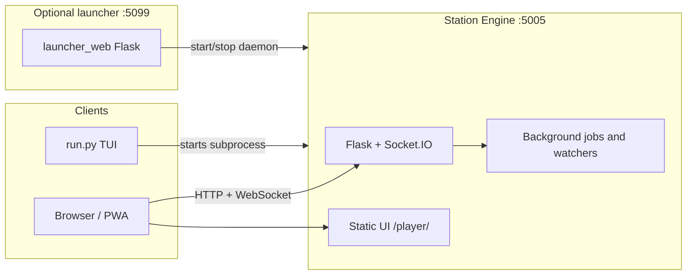

## ARQUITECTURA – Descripción general del sistema

Este documento describe cómo está estructurado el repositorio Soundsible, qué procesos se ejecutan, dónde y cómo fluyen los datos entre los componentes. Para obtener detalles sobre la implementación y la conexión en red, consulte [INSTALL.md](INSTALL.md); para perillas y variables de entorno, consulte [CONFIGURATION.md](CONFIGURATION.md).

### 1. modelo mental

Soundsible es un **entorno musical autoalojado**: un **Station Engine** en Python expone una API HTTP y eventos en tiempo real, sirve la interfaz web de **Station** y coordina la gestión de la biblioteca, el estado de reproducción y las descargas. Un **lanzador web** independiente y opcional ayuda a iniciar el demonio del servidor desde un navegador. Los flujos opcionales de la **CLI** usan los mismos puntos de entrada del motor.

En tiempo de ejecución, normalmente tienes uno de estos modos de motor:

- **Demonio del servidor** (`run.py --daemon`): un proceso que escucha en el **puerto 5005** de forma predeterminada (`STATION_PORT` en `shared/constants.py`). Ejecuta Flask, Socket.IO (modo asíncrono **gevent**) y tareas en segundo plano (cola de descargas, supervisión de archivos y sincronización opcional de la biblioteca).
- **Motor de escritorio**: un proceso que se inicia con `run.py --desktop-engine` o `soundsible_engine.py`. De forma predeterminada, escucha en **`127.0.0.1` en un puerto libre aleatorio**, escribe el estado de ejecución en el directorio de configuración de la aplicación y emite una única línea JSON que indica que está listo por la salida estándar antes de los registros normales de inicio.
- **Lanzador web**: aplicación Flask opcional en el **puerto 5099** (`start_launcher.py` / `launcher_web/`). **No** sirve el reproductor; solo ayuda a iniciar o detener el motor y a ejecutar la interfaz de configuración inicial.

La interfaz de usuario de **Station** es una aplicación SolidJS responsiva en `ui_web/`, atendida por el motor en **`/player/`** y **`/player/desktop/`**. Ambas rutas utilizan la misma interfaz; la ruta del escritorio recibe además el arranque del token de propietario requerido por el shell del escritorio. La interfaz de usuario se comunica con el motor a través de REST y WebSocket (Socket.IO).

### 2. Diseño del repositorio (nivel alto)

| Área | Función |
|------|------|
| `run.py` | Punto de entrada universal: prepara el entorno virtual y después abre el menú **TUI**, el servidor **`--daemon`** (también lo que ejecuta systemd) o el modo de escritorio **`--desktop-engine`**. |
| `soundsible_engine.py` | Punto de entrada independiente del motor de escritorio que envuelve `run.py --desktop-engine`. |
| `shared/` | Código transversal: aplicación de la API Flask (`shared/api/`), modelos, rutas de configuración, utilidades de seguridad, acceso a SQLite, orquestación de trabajos, archivos de audio (`shared/audio_files.py`) y proceso de descarga (`shared/downloader/`: yt-dlp, FFmpeg, el grupo de descargas y la sincronización en la nube). |
| `player/` | Gestor de biblioteca, cola, favoritos, caché: lógica **central de reproducción y biblioteca** que usa la API. |
| `ui_web/` | Interfaz de Station con SolidJS + TypeScript y compilación con Vite; incluye **Descubrir** (metadatos de Deezer + resolución de YouTube). |
| `launcher_web/` | Pequeña aplicación Flask para las páginas del lanzador y la API de «iniciar/detener el ecosistema». |
| `setup_tool/` | Proveedores de almacenamiento (carpeta local, Cloudflare R2, Backblaze B2), análisis y subidas que usan los flujos de biblioteca y sincronización. |

### 3. Vista de procesos y redes



- **Inicio del demonio del servidor**: `shared/daemon_launcher.py` (menú de terminal y lanzador web) inicia el Python de `venv` con `run.py --daemon`, que llama a `shared.api.start_api()` y escucha en **0.0.0.0:5005**.
- **Inicio del motor de escritorio**: `soundsible_engine.py` o `run.py --desktop-engine` construye un `RuntimeConfig`, crea un archivo con un token corto de propietario y un token de autenticación correspondiente con permisos limitados, escribe `desktop-engine-state.json` en el directorio de configuración y después inicia `shared.api.start_api()` en la interfaz de bucle local.
- **CORS**: la configuración CORS predeterminada de REST permite localhost, la LAN privada y rangos de tipo Tailscale, salvo que se sustituya con `SOUNDSIBLE_ALLOWED_ORIGINS`. El CORS de Socket.IO se puede restringir con `SOUNDSIBLE_SOCKET_CORS_ORIGINS`.

### 4. Partes internas del motor de la estación

La aplicación Flask se encuentra en `shared/api/__init__.py`. Eso:

- Registra planos para **biblioteca**, **reproducción**, **descargador**, **config**, **descubrimiento**, **podcasts** y **agente** (`shared/api/routes/`).
- Sirve el reproductor web en `/player/`: prefiere la compilación `ui_web/dist` cuando está presente, recurriendo al árbol de fuentes `ui_web` (anular con `SOUNDSIBLE_WEB_UI_DIST=0/1`).
- Contiene singletons para **LibraryManager**, **QueueManager**, **FavouritesManager** y el subsistema de descarga.
- Utiliza **Socket.IO** para actualizaciones en vivo (por ejemplo, cambios en la biblioteca, progreso del descargador, coordinación de reproducción).

**Contrato de sidecar de escritorio**:

- El motor de escritorio emite un evento de preparación JSON delimitado por nueva línea en la salida estándar con `base_url`, `host`, `port`, `pid`, `version`, `health` y `owner_token_file`.
- El estado de tiempo de ejecución se refleja en `desktop-engine-state.json` en el directorio de configuración para que un futuro shell de escritorio pueda detener solo el proceso de propiedad mediante PID en lugar de eliminarlo por puerto.
- `GET /api/health` devuelve directorios de tiempo de ejecución, tiempo de actividad, ruta del archivo del token del propietario, estadísticas de la biblioteca y estado activo del trabajo en segundo plano para el diagnóstico del shell.
- `/player/desktop/` ahora recibe el token de propietario a través de la inyección de arranque HTML (`meta` + `window.__SOUNDSIBLE_OWNER_TOKEN__`) para que el reproductor de escritorio pueda llamar a rutas protegidas por el propietario sin hacks de cadenas de consulta.

**Primitivas de emparejamiento**:

- Los propietarios crean sesiones de vinculación de corta duración con **`POST /api/pairing/sessions`** y pueden consultarlas con **`GET /api/pairing/sessions`**.
- Los datos de las sesiones incluyen ahora metadatos de conexión listos para QR: posibles URL base de LAN, URL de vinculación y del reproductor, y un contenido JSON compacto `qr_text` adecuado para codificarlo directamente en un código QR.
- Los clientes solicitan la vinculación con un código visible mediante **`POST /api/pairing/sessions/claim`**.
- Los propietarios completan o cancelan el proceso mediante **`POST /api/pairing/sessions/<id>/confirm`** y **`POST /api/pairing/sessions/<id>/cancel`**.
- La interfaz contenedora puede indicar explícitamente que el panel del QR está abierto o cerrado mediante **`POST /api/pairing/sessions/<id>/display-open`** y **`POST /api/pairing/sessions/<id>/display-close`**. Si `auto_confirm` está activado mientras el panel está abierto, una solicitud de vinculación puede completarse de inmediato sin un segundo intercambio con el propietario.
- Una confirmación correcta crea un token de portador `paired_device` con permisos limitados en `auth_tokens`; los propietarios pueden listar y revocar esos tokens con **`GET /api/paired-devices`** y **`POST /api/paired-devices/<token_id>/revoke`**.
- Una solicitud de vinculación puede pedir en su lugar `"credential": "session"` (la aplicación de Android lo hace): solo mientras el panel del propietario esté abierto con confirmación automática, inicia sesión en el teléfono con la cuenta que muestra el código mediante una cookie de sesión normal, con todos los permisos de la cuenta, no con el conjunto reducido de un dispositivo vinculado. Esa sesión queda asociada al registro de vinculación, por lo que aparece en la lista y se puede revocar mediante las mismas rutas de dispositivos vinculados. Un código oculto se rechaza con `pairing_display_required` y queda sin usar.
- Configuración → Dispositivos dibuja el QR. El panel usa la dirección desde la que se está viendo (en la aplicación de Android, la de su servidor conectado) y solo recurre a la sugerencia de LAN del motor si se accede desde una dirección de bucle local, ya que el motor no puede conocer una dirección HTTPS o de Tailscale.

**Orquestación de trabajos** (`shared/api/orchestrator.py`): un pequeño **JobOrchestrator** serializa las escrituras de metadatos y ejecuta trabajos simultáneos limitados (por ejemplo, descargas) para que las tareas pesadas no acaben con la biblioteca.

**Almacenamiento en caché y vuelo único** (`shared/api/memo.py`): cada ruta lenta en la API es una llamada yt-dlp medida en segundos: búsqueda de texto, resolución de URL de transmisión, combinaciones relacionadas. `Memo` les proporciona un caché TTL **limitado** más un **vuelo único**: las personas que llaman simultáneamente para una clave se colapsan en la que llegó primero y comparten su resultado. Esto es importante porque un caché TTL solo ayuda *después* de que regresa la primera llamada; mientras está en vuelo, la entrada está ausente, por lo que N solicitudes simultáneas de la misma cosa pagan el precio completo. Esa es exactamente la forma de un oyente que toca una vista previa repetidamente, o una búsqueda previa especulativa que acelera el clic que debía hacer instantáneo. Utilizado por:

| Camino                                                            | TTL                   | Notas                                                                                                                         |
| ----------------------------------------------------------------- | --------------------- | ----------------------------------------------------------------------------------------------------------------------------- |
| `_get_preview_stream_url_cached` (reproducción)                   | 5 min, 20 s negativo  | Un vídeo que no se puede resolver se recuerda brevemente, por lo que una tormenta de reintentos no es una tormenta de yt-dlp. |
| `_resolve_candidates` (catálogo)                                  | 30 s                  | Sólo ventana de vuelo; el caché duradero es SQLite `get_cached_resolution`.                                                   |
| `youtube/search`, `youtube/peek`, `youtube/related` (descargador) | 5 min / 1 min / 5 min | `related` también vuelve a verificar el caché persistente de SQLite dentro del vuelo.                                         |

La resolución del catálogo pone en cola la resolución de la URL de transmisión del ganador en el **trabajador de captación previa de vista previa** en lugar de bloquear la respuesta: el clic que sigue encuentra la URL activa o se une a la extracción que ya se está ejecutando.

**Proceso de descarga**: los elementos en cola se procesan en segundo plano; las pistas completadas se incorporan a los metadatos de la biblioteca principal (`add_tracks_to_user_library`; `_sync_pool_to_main_core` para operaciones administrativas sobre todo el repositorio compartido). Un MBID de grabación del catálogo atraviesa la cola como evidencia de adquisición, se guarda en la pista y se incrusta mediante la correspondencia de etiquetas estándar de MusicBrainz Picard (MP3, FLAC, MP4/M4A, Ogg Vorbis y Opus; los archivos WebM se dejan sin etiquetar); los análisis de carpetas recuperan el mismo identificador de los archivos etiquetados compatibles. FFmpeg y yt-dlp se usan mediante `shared/downloader/`.

**Ruta de la biblioteca**: `player/library.py` carga los canónicos **`library.db`** y **`~/.config/soundsible/config.json`** de cada cuenta para `PlayerConfig`; también puede utilizar proveedores de almacenamiento de `setup_tool/` para exportaciones respaldadas en la nube. Una transacción SQLite almacena la instantánea completa de la biblioteca: pistas y listas de reproducción ordenadas, configuraciones, estado del podcast, `artists`/`albums`/`track_artists` normalizado y `track_user_state`. Los ID de entidad son deterministas y los álbumes incluyen al artista del álbum, por lo que los registros no relacionados con el mismo título no colapsan. Después de que se confirma esa transacción, Soundsible actualiza atómicamente `library.json` como una exportación portátil; un error de exportación no revierte la biblioteca.

Cada pista lleva **`added_at`**, el momento en que *esta cuenta* incorporó la canción por primera vez. Lo decide una única regla, gestionada por `shared/library_dates.py`: la fecha se escribe una sola vez, cuando una canción entra en la biblioteca, y cualquier otra forma que adopte después esa misma canción la conserva. Descargar una canción que habías guardado conserva el día en que la guardaste; marcar como favorita una canción descargada toma como fecha de incorporación la del archivo; un análisis de carpetas que encuentra el archivo de una canción guardada conserva la fecha en que se guardó. `Holdings.claim` es el único punto de decisión: una identidad que la cuenta ya tiene (como archivo o como entrada guardada, comparada mediante las mismas claves de identidad que usa el reproductor) devuelve la fecha desde la que se conserva, y solo una identidad que no figure en ninguna parte recibe una nueva. La fecha propia del repositorio compartido nunca es la de una cuenta: indica cuándo *el repositorio* obtuvo el archivo. Una vez guardada, la fecha de una pista se conserva aunque cambie su identificador y nunca se reescribe. No se corrigen retroactivamente las fechas de una biblioteca escritas antes de esta regla; sería una suposición. Esto es lo que significa «añadido recientemente» en el reproductor, en `newest` de `getAlbumList2` y en `created` de un álbum de Subsonic. Una biblioteca anterior a la existencia de la columna recibe sus fechas una sola vez, al abrirse, a partir del mtime de cada archivo; si no se puede acceder a un archivo, se recurre a su posición en el manifiesto. No se usa `last_updated` deliberadamente, porque cada fila contiene el instante de la última reescritura. El reproductor combina los archivos con las canciones guardadas pero no descargadas usando este único campo y, como ambas formas de una canción llevan la misma fecha, descargarla o marcarla como favorita nunca cambia su posición en ese orden.

`POST /api/library/scan` pone en cola un análisis con ámbito de cuenta en la línea de fondo limitada en disco del orquestador. Lee las raíces musicales configuradas en su lugar y fusiona su delta con la revisión más reciente de SQLite bajo el bloqueo de metadatos serializados, por lo que un escaneo no puede sobrescribir una descarga simultánea. Las rutas absolutas y los tiempos de archivo siguen siendo campos SQLite locales de la máquina y están excluidos de `library.json`. La reproducción los acepta solo mientras sus objetivos resueltos permanezcan dentro de una raíz configurada actualmente. Los nuevos escaneos agregan o cambian la clave de los archivos, pero nunca eliminan los que faltan; la eliminación sigue siendo una acción de mantenimiento explícita.

**Exploración del catálogo**: `shared/api/routes/library_catalog.py` sirve `/api/library/albums`, `/api/library/artists`, `/api/library/genres` y `/api/library/years` desde esa misma proyección normalizada, por lo que el reproductor explora los registros y los créditos que explora `/rest` en lugar de reagrupar el manifiesto plano en el navegador, lo que convirtió una cadena de visualización en un intérprete y fusionó dos registros que comparten un título. Los pedidos de álbumes se validan con respecto a `DatabaseManager.ALBUM_ORDERINGS`, la tabla por la que se ordena `getAlbumList2`, por lo que las dos superficies no pueden estar en desacuerdo sobre lo que significa "por año". Las entidades responden con identificadores de pistas: el reproductor ya tiene todas las pistas que puede reproducir, codificadas por identificación, con su marca favorita y lectura de volumen adjunta.

Una cuenta sin un marcador canónico se migra una vez utilizando la precedencia manifiesta anterior. Su manifiesto config-dir se conserva como `library.json.pre-sqlite.bak`; Las cuentas nuevas reciben una base de datos canónica vacía. Después de la migración, las ediciones JSON y los mtimes se ignoran: se observan otros escritores durante la revisión SQLite y `/api/library/sync` recarga SQLite y regenera las exportaciones.

**Ruta OpenSubsonic**: `shared/api/routes/subsonic.py` sirve a `/rest`, leyendo ese mismo catálogo y sirviendo bytes a través de la ruta que usa `/api/static/stream`. `shared/subsonic/` contiene lo que las vistas deciden: el sobre XML/JSON/JSONP, la credencial por cuenta (cifrada, porque el protocolo de enlace `md5(password + salt)` no se puede comparar con un hash), los serializadores `Child`/`AlbumID3`/`ArtistID3` y la transcodificación ffmpeg. Esta superficie está **fuera de `/api`**, por lo que el gancho `before_request` la deja anónima y se autentica, sin ningún atajo de red confiable, ya que se puede acceder a ella a través de un embudo. Consulte [OpenSubsonic](OPENSUBSONIC.md).

**Registro y transferencia de dispositivos**:

- Los clientes se registran con **`POST /api/devices/register`** usando `device_id`, `device_name` y `device_type` (`mobile`, `desktop` o `agent`). El registro es local del proceso y su alcance se realiza a través del mismo solucionador de alcance de reproducción que el estado de reproducción.
- Los clientes de Socket.IO aún se unen a salas **`playback:{scope}:{device_id}`** a través de `playback_register`; ese evento también actualiza el registro de los clientes web existentes.
- El estado de reproducción permanece aislado por `scope` y `device_id`. Los clientes publican el estado con **`PUT /api/playback/state`** y las solicitudes de detención usan **`POST /api/playback/notify-stop`**.
- **`POST /api/playback/handoff`** lee el estado del dispositivo de origen, emite `playback_stop_requested` a `playback:{scope}:{from_device_id}`, escribe el estado del dispositivo de destino con el asistente de estado de reproducción existente y emite `playback_start_requested` a `playback:{scope}:{to_device_id}`. No transmite a través de ámbitos ni salas sin ámbito.

**API del agente**:

- Los tokens de agente se crean con **`POST /api/agent/token`**. Esta ruta está protegida por el administrador utilizando la misma política que otras rutas de administrador (`SOUNDSIBLE_ADMIN_TOKEN` cuando está configurada; de lo contrario, compatibilidad confiable con LAN/Tailscale).
- Los tokens de autenticación con alcance se almacenan en SQLite `auth_tokens` únicamente como hashes. El motor de escritorio usa un token `owner` y los agentes usan tokens `agent` con alcance. Las rutas de agentes heredadas aún conservan la compatibilidad con la tabla `agent_tokens` anterior.
- Los agentes se autentican con `Authorization: Bearer <token>` o `X-Soundsible-Agent-Token`.
- **`GET /api/agent/verify`**, **`POST /api/agent/play`** y **`POST /api/agent/command`** requieren `@require_agent_token`.
- El control del agente se dirige a un `device_id` suministrado o al dispositivo que no es agente registrado más recientemente en el alcance actual. Los comandos se emiten a las salas `playback:{scope}:{device_id}` y reutilizan el estado de reproducción para inicios estilo `play`/handoff.

**Buscar proveedores y fuentes de descubrimiento** (`shared/api/routes/discovery.py`, `shared/discovery_intelligence.py`):

- El navegador no puede llamar a `api.deezer.com` (CORS). Station expone **`GET /api/discovery/deezer/<path>`**, que solo reenvía rutas de Deezer **incluidas en la lista de permitidas** (por ejemplo, `chart`, `search`, `playlist/<id>`, `track/<id>`, `artist/<id>/top`) y devuelve el JSON de Deezer sin cambios.
- Las peticiones tienen **un límite de frecuencia** por IP (`discovery_deezer`). El motor necesita **conexiones HTTPS salientes** a Deezer.
- **`GET /api/discovery/music/feed`** es un contrato interno de descubrimiento con resultados ordenados por relevancia. Reúne
  candidatos de la biblioteca local,
  los favoritos, las listas de reproducción, el historial de escucha, Deezer y las relaciones de YouTube
  almacenadas en caché; después, el servidor ordena las secciones por relevancia, diversifica los artistas y elimina
  los duplicados entre secciones. Se devuelve un resultado local sin esperar a
  la extracción de los proveedores, mientras la respuesta más completa se actualiza en
  segundo plano y se sirve la versión anterior mientras se revalida.
- Los conjuntos de descubrimiento para reproducción pueden consumir ese contrato sin cambiar la
  presentación existente de **Búsqueda**. **Biblioteca** sigue siendo la ruta raíz.
- **`POST /api/discovery/music/plan`** es el contrato de escucha generada para
  Reproducción automática, Radio y DJ. Station reúne candidatos locales reproducibles,
  relacionados con el punto de partida, del grafo en caché y de artistas; aplica el perfil de la cuenta,
  la diversidad, las exclusiones y la política de intención/perfil, y después devuelve el
  segmento final ordenado. Un único coordinador del navegador gestiona la cancelación,
  los reintentos y la reposición; nunca vuelve a ordenar la respuesta del servidor.
- Radio sigue siendo el modo explícito de «más de esto ahora» y repone su contenido continuamente.
  DJ usa el contrato compositivo v6: las apariciones de pistas en la ruta determinan
  qué sonará, mientras que las fuentes efímeras visibles orientan de forma independiente la
  secuencia generada de próximas pistas. Las fuentes se acumulan y la más reciente abre una
  sesión; las pistas escuchadas solo aportan contexto móvil de un salto después de
  sonar realmente. La posición exacta y las exclusiones siguen siendo locales a la sesión, sin
  estado de puntos de paso ni un límite musical estricto. La ruta procede de recorridos estocásticos
  por el grafo a partir de las fuentes. Se elige una muestra determinista antes de leer
  los análisis; después, las canciones medidas se ordenan por la calidad de las transiciones y la continuidad
  en notas/s, LUFS, planitud espectral y tempo, ajustadas según la dispersión
  de la propia muestra. Las canciones no medidas conservan sus posiciones en la muestra. El análisis de la señal
  también da forma a cada transición: las secciones finales o de ruptura medidas sitúan la salida, y
  un drop entrante puede coincidir con una frase saliente a la velocidad de reproducción
  aplicada. La fiabilidad del tempo determina si se permite sincronizar los pulsos, independientemente de la confianza tonal.
  La interpretación de las secciones permanece en el servidor; la web y Android ejecutan los
  mismos puntos de entrada y salida acotados. No usa un LLM ni aplica silenciosamente el perfil
  global de gustos de la cuenta.
  El mapa de responsabilidades del DJ, sus contratos y las diferencias entre
  políticas de ruta están en [Arquitectura del DJ](dj/ARCHITECTURE.md). La fachada
  `shared/dj_engine.py` conserva los imports públicos; `shared/dj/store.py`
  posee la única caché y los trabajos, y los módulos musicales son puros.
  Reproducción automática sigue siendo una continuación invisible con contexto finito. Búsqueda no
  usa el planificador de cola y su interfaz no cambia.
- **La reproducción y las descargas** de esas filas **no** usan audio de Deezer. La interfaz ejecuta una **búsqueda de texto en YouTube / YouTube Music** (la misma ruta `/api/downloader/youtube/search` que usa el descargador) con el título y el artista de Deezer, elige un identificador de vídeo coincidente y después:
  - La **previsualización dentro de la aplicación** se reproduce en streaming mediante **`GET /api/preview/stream/<video_id>`** (blueprint de reproducción).
  - La **cola de descargas** usa el elemento resuelto como cualquier otro resultado de búsqueda.
- La resolución puede tardar unos segundos; el panel emergente de la cola de descargas puede mostrar brevemente el estado **«Buscando una coincidencia en YouTube…»** mientras se ejecuta esa búsqueda.

**Búsqueda universal** (`shared/api/routes/catalog.py`):

- `GET /api/catalog/search` ejecuta en paralelo los proveedores de la biblioteca, Deezer, MusicBrainz y
  YouTube normal, y devuelve una única lista mixta ordenada
  de forma determinista. Los fallos de los proveedores se notifican como fallos parciales; los resultados
  restantes siguen siendo utilizables.
- La clasificación depende solo de la consulta. Nunca lee señales de recomendación, favoritos ni
  preferencias de la cuenta, ni siquiera para desempatar. Tener un elemento en la biblioteca se indica con una insignia de estado de acción,
  no mejora su posición.
- El proveedor de la biblioteca obtiene sus candidatos de un índice en disco con texto normalizado en
  `library.db` (`shared/library_search.py`) solo cuando una huella demuestra que el
  índice describe la biblioteca en memoria; de lo contrario (cambios sin guardar o un índice
  desactualizado), examina todas las pistas. En ambos casos, el mismo clasificador ordena las mismas filas;
  consulta [Índice de búsqueda local](performance/local-search-index.md).
- **El servidor controla la disposición.** La respuesta incluye `top_result` (un identificador de elemento
  o `null`) y una lista ordenada `sections` de
  `{id, layout, item_ids, total}`; `layout` es uno de
  `hero | rows | grid | grid_round`, y `total` es el recuento anterior al límite, para que un cliente
  pueda ofrecer «ver los N resultados» sin volver a consultar. El orden de las secciones forma parte de la
  respuesta: una consulta con el nombre de un artista empieza por artistas; una con el nombre de un álbum, por álbumes.
  Todas las interfaces de búsqueda muestran ese mismo orden (`ui_web/src/lib/searchSections.ts`);
  la ruta Búsqueda y el panel NORMAL antes tenían dos órdenes distintos fijados en el código.
  Los clientes envían `type=all` y filtran las pestañas localmente: una petición `type=artist` requiere
  consultar a todos los proveedores para obtener una respuesta estrictamente menor.
- **`top_result` está sujeto a condiciones, no es simplemente «la primera fila».** Solo se incluye si supera un
  umbral de puntuación y, además, un artista o álbum debe superar por cierto margen la mejor fila de
  otro tipo; de lo contrario, lo habría decidido únicamente la bonificación por tipo, que
  no es una prueba. Es preferible no mostrar una tarjeta a mostrar una incorrecta: es el objetivo de interacción más grande
  de la página y, si representa una entidad, lleva a otra página.
- **Señales de clasificación**, todas derivadas de la consulta y de las filas que los proveedores
  acaban de devolver: coincidencia escalonada de título/artista sobre texto con acentos normalizados
  (`shared/text_utils.fold_text`), con coincidencia de términos sin importar el orden; un factor
  de cobertura para que un título que la consulta cubre casi por completo supere a uno largo del que solo coincide el principio
  (primero se elimina el texto promocional habitual de los lanzamientos, por lo que `(Official Video) [HD]` no
  penaliza); popularidad ordenada *dentro* de cada grupo `(source, type)` y limitada
  por debajo del nivel de coincidencia textual más bajo, ya que la popularidad bruta no se puede comparar entre
  proveedores y una fuente que no la publica recibe la puntuación intermedia neutra; una
  bonificación de corroboración cuando varios proveedores nombran la misma entidad; y una
  bonificación por intención de artista/álbum cuando suficientes canciones de las primeras posiciones comparten un nombre que
  también coincide con la consulta.
- Las filas de distintos proveedores que se resuelven a la misma grabación se fusionan en
  una sola. La fila que se conserva y su posición se eligen por una puntuación basada solo en la consulta;
  la presencia en la biblioteca solo se incorpora al estado de acción de la fila conservada, de modo que una copia propia permite
  reproducirla al instante sin subirla en la página. Las filas cuyas duraciones
  difieren en más de unos pocos segundos se tratan como versiones distintas y se mantienen
  separadas. Las filas de YouTube se excluyen de la fusión basada en el título, porque sus
  títulos incluyen al artista y el análisis necesario para hacerlos coincidir es el cambio con más
  probabilidades de ocultar precisamente la fila que alguien buscaba.
- Los resultados públicos repetidos de un creador pueden aportar una corrección de intención a una edición
  de distancia (`fari` → `El Fary`). Las coincidencias literales permanecen en la respuesta.
- Los cuerpos de las respuestas de búsqueda, artista y álbum se almacenan en `Memo` (`shared/api/memo.py`),
  que tiene un tamaño limitado *y* agrupa las peticiones en curso: las llamadas simultáneas para una misma consulta comparten
  una única consulta a los proveedores en lugar de ejecutar cada una la suya. Las claves se separan por cuenta
  porque los cuerpos incluyen el estado `in_library`.

**Perfil de recomendación local** (`shared/discovery_intelligence.py`, `shared/database.py`):

- Cada cuenta tiene tablas transaccionales `discovery_events` y
  `discovery_signals` en su propio `library.db`, además de un archivo local
  `listening-events.jsonl` que se puede inspeccionar.
- Descubrir, Radio, DJ, Reproducción automática y las recomendaciones de pódcasts usan exactamente el mismo
  multiplicador por identidad. `not_interested` es una señal suave, monótona, reversible y
  con un límite inferior mayor que cero; nunca se convierte en una lista de bloqueo. Búsqueda y las colas manuales no
  llaman a este clasificador.

### 4A. Contrato de carga de reproducción (cliente)

El motor no puede hacer que una vista previa en frío sea instantánea (hay una extracción yt-dlp detrás), por lo que la interfaz de usuario está diseñada para hacer que la espera sea *legible e idempotente* en lugar de fingir que no está allí. Tres reglas, todas en `ui_web/src/stores/index.ts` y `ui_web/src/lib/audio.ts`:

- **Idempotente.** `loadIndex` trata una petición de la entrada que ya está activa como una operación sin efecto (o como una reanudación, si está en pausa). Los toques repetidos en una fila no cuestan nada; solo `{ restart: true }` vuelve a reproducir desde 0:00. `playCatalogItem` (`lib/catalogItem.ts`) hace lo mismo con las filas que aún necesitan resolverse.
- **Gana el último clic.** Asignar `src` cancela la obtención anterior y `audio.ts` etiqueta cada intento con un número de secuencia para que el rechazo de `play()` del intento sustituido —un `AbortError`— se descarte en lugar de notificarse como un fallo de la nueva pista. `audioService.stop()` (finalización, no pausa) vacía `src` para que el motor deje de transmitir bytes que nadie está escuchando.
- **Visible.** `playback.isLoading` / `playback.loadError` controlan un indicador giratorio y una animación de progreso indeterminado en OmniBar y los controles de reproducción de NORMAL, una opción para reintentar si hay un fallo y un indicador giratorio en la fila concreta que se ha pulsado. Si una pista falla, se pasa automáticamente a la siguiente, con un límite de 3 saltos consecutivos.

Una carga fallida aparece en dos canales (`play()` rechaza **y** el elemento activa `error`), por lo que el informe de fallas se basa en una generación de carga: el primer informe retira el intento y el duplicado se ignora.

### 4B. Contrato de cola de reproducción (cliente)

El reproductor Solid usa carriles manuales, de contexto y generados basados en apariciones.
Su único coordinador de sesiones generadas y las reglas de ordenación, sustitución,
reproducción aleatoria, Radio, DJ y Reproducción automática se definen de forma normativa en
[`PLAYBACK_QUEUE_CONTRACT.md`](PLAYBACK_QUEUE_CONTRACT.md).

### 5. Datos y configuración (conceptual)

Un motor atiende a **varias cuentas**. El Estado se divide en dos: lo que pertenece a la máquina y lo que pertenece a la persona.

**Nivel de instancia** (una copia, administrada por el administrador):

| Ubicación | Finalidad |
|----------|---------|
| `<config>/instance.db` | Cuentas, credenciales (`auth_tokens`, `agent_tokens`), sesiones de vinculación y cachés direccionadas por contenido que comparten todos los usuarios (resolución de YouTube, mezclas relacionadas, letras). |
| `<config>/config.json` | Sistema de almacenamiento y credenciales (`PlayerConfig`). |
| `<config>/output_dir`, `<config>/music_dir.json` | Dónde se encuentra el repositorio compartido de música. |
| `<config>/cookies.txt` | Cookies de yt-dlp. |
| `<config>/download_queue.json` | Una única cola; cada fila incluye `user_id`. |
| `<music>/tracks/<hash>.<ext>` | **Repositorio de audio compartido.** El identificador de la pista *es* el hash del contenido, por lo que dos personas que tienen la misma canción apuntan al mismo archivo: nada se descarga ni se guarda dos veces. |
| `<music>/library.json` | Catálogo de la instancia con lo que existe físicamente en disco (lo escribe el grupo de descargas, `shared/downloader/`). |
| `<cache>/previews/`, `<cache>/covers/` | Compartidos y direccionados por contenido. |
| `<data>/telemetry/` | `setup-events`, `migration-events`. |

**Por cuenta**, bajo `<config>/users/<user_id>/` y `<data>/users/<user_id>/`:

| Archivo | Finalidad |
|------|---------|
| `library.db` | Biblioteca canónica: pistas y listas de reproducción ordenadas, ajustes, estado de los pódcasts, catálogo normalizado de artistas y álbumes, estado por pista y rutas y huellas de análisis locales del equipo. También contiene un índice de búsqueda local derivado, que se regenera a partir de esas filas cuando hace falta. |
| `library.json` | Exportación portátil de tu biblioteca canónica para recuperación e interoperabilidad con la nube. La primera migración también conserva `library.json.pre-sqlite.bak`. |
| `favourites.json`, `playback_state.json`, `discovery_settings.json` | Canciones guardadas, reanudación entre dispositivos y activación voluntaria del descubrimiento. |
| `queue_state.json` *(directorio de datos)* | Cola de reproducción. |
| `telemetry/listening-events.jsonl`, `telemetry/play-timing.jsonl` *(directorio de datos)* | Historial de escucha: la información que alimenta *tus* recomendaciones. |

La edición de las etiquetas de una pista vuelve a codificar el archivo y, por lo tanto, cambia su hash, lo que genera una nueva identificación de pista. Eso es lo que mantiene privadas las ediciones de metadatos: su manifiesto sigue la nueva identificación mientras que todos los demás conservan la original.

**Los favoritos usan claves de identidad, no de identificador.** `favourites.json` (v3) contiene
entradas ordenadas, con las más recientes primero:

```json
{"version": "3.0", "saved": [
  {"keys": ["lib:9f2a…", "yt:dQw4w9WgXcQ"], "title": "…", "artist": "…",
   "duration": 355, "thumbnail": null, "favourite": true,
   "added_at": "…", "favourited_at": "…"}
]}
```

`keys` es el conjunto de identidades con espacio de nombres que corresponden a la canción: los mismos
espacios de nombres que usa el reproductor para seguir una canción entre saltos (`lib:`, `yt:`, `isrc:`,
`mb:`, `deezer:`, `cat:`; consulta `ui_web/src/lib/playbackIdentity.ts`). Dos entradas
son la misma canción cuando sus conjuntos de claves se intersectan. Eso es lo que permite guardar una
canción que no has descargado: la instantánea basta para mostrarla y reproducirla en streaming,
y la entrada se resuelve frente a la biblioteca *en el momento de la lectura*, de modo que descargarla
más adelante convierte esa misma entrada en la pista propia sin reescribir nada. Los archivos v1
(una matriz plana de identificadores de pista) se migran al cargarse. La derivación de claves está en el
cliente; `player/favourites_manager.py` solo almacena, ordena y calcula intersecciones.
`added_at` es la fecha de incorporación de la canción a la biblioteca (la misma que lleva su archivo, consulta
más arriba); `favourited_at` es el momento en que se marcó como favorita y solo existe mientras siga marcada:
marcar una canción no es incorporarla a la biblioteca, así que nunca modifica la fecha de incorporación.

Los nombres de archivos y campos exactos pueden evolucionar; Trate el código bajo `shared/` y `player/` como la fuente de la verdad.

### 5A. Cuentas, sesiones y la puerta de identidad

- Las **cuentas** se gestionan en `shared/users.py` (política), sobre la tabla `users`. Los roles son
  `admin` y `member`. Las contraseñas se guardan como hashes scrypt (`werkzeug.security`).
- Las **sesiones** son tokens opacos de 32 bytes que se guardan *solo como hashes SHA-256* en
  `auth_tokens`, con `kind='session'` y un `user_id`, y se entregan como una cookie HttpOnly
  `sb_session`. La cookie se envía con la negociación inicial de Socket.IO, por lo que
  la autenticación en tiempo real no requiere trabajo adicional.
- **`instance_requires_login()`** es el interruptor. Es `False` en un único
  caso: una sola cuenta sin contraseña, que es el estado de una instalación migrada de un solo usuario;
  pasa a ser `True` en cuanto existe una segunda cuenta o se establece una
  contraseña para la única cuenta.
- **Un único control de acceso, no 126 decoradores.** `before_request`, en `shared/api/__init__.py`,
  identifica a quien realiza la llamada, devuelve **401** para cualquier `/api/*` fuera de una pequeña lista pública
  de rutas permitidas (`/api/auth/state`, `/api/auth/login`, `/api/auth/logout`,
  `/api/health`, `/api/pairing/sessions/claim`) y vincula el usuario durante el resto
  de la petición. Los gestores de las capas inferiores resuelven sus rutas mediante esa vinculación
  (`shared/user_context.py`), y solicitar un directorio de usuario sin ningún usuario vinculado
  provoca una excepción en lugar de recurrir silenciosamente a una alternativa.
- **Permisos**: los miembros tienen `library:read`, `library:write`, `playback:control`,
  `download:add`, `admin:config` (sus propias preferencias). Los administradores también tienen
  **`admin:instance`** —carpeta de música, sistema de almacenamiento, ajustes del descargador,
  sincronización en la nube y gestión de cuentas—, además de `admin:dangerous`.
- **Aislamiento en tiempo real**: cada socket se une a una sala `user:{user_id}`;
  `library_updated` y `downloader_*` se emiten ahí y nunca se difunden a todos.
  Las salas de reproducción siguen siendo `playback:{scope}:{device_id}`, donde el ámbito es el identificador del usuario.
- La **migración** (`shared/multiuser_migration.py`) se ejecuta en cada arranque y es
  idempotente. En una instalación anterior al soporte multiusuario, crea la cuenta de administrador, mueve el
  estado antes no jerarquizado a `users/<id>/`, copia las tablas de la instancia desde el antiguo
  `library.db` (para conservar los dispositivos vinculados y las cachés ya preparadas) y deja los
  originales renombrados como `*.singleuser.bak`.

### 6. Notas de seguridad (breves)

- **Refuerzo de ruta y red** en vivo en `shared/security.py` y `shared/hardening.py` (por ejemplo, acciones de administrador en el lanzador, límites de velocidad, encabezados de respuesta).
- El registro de reproducción utiliza salas Socket.IO con alcance para que la semántica de parada/reanudación se mantenga coherente en todas las pestañas/dispositivos donde se implemente.
- REST CORS está controlado por `SOUNDSIBLE_ALLOWED_ORIGINS`; incluya orígenes de aplicaciones móviles allí cuando no estén cubiertos por los patrones localhost/LAN/Tailscale predeterminados. Las solicitudes de agentes pueden usar `Authorization` o `X-Soundsible-Agent-Token`, ambos permitidos por API CORS.

### 7. Documentación relacionada

- [INSTALL.md](INSTALL.md) — operación sin cabeza, proxy inverso, Tailscale.
- [VPS\_RELAY.md](VPS_RELAY.md): salida residencial privada verificada para hosts VPS bloqueados por bots.
- [AGENT\_INTEGRATION.md](AGENT_INTEGRATION.md) — Guía API para OpenClaw, agentes Hermes y asistentes locales.
- [CAR\_INTEGRATION.md](CAR_INTEGRATION.md): superficies multimedia del automóvil, `/api/car/*` y contrato complementario nativo.
- [CONFIGURATION.md](CONFIGURATION.md): superficies de configuración y variables de entorno.
- [troubleshooting-yt-dlp-formats.md](troubleshooting-yt-dlp-formats.md): problemas con el formato yt-dlp al utilizar cookies.
- [LEGAL.md](LEGAL.md) — uso aceptable.
